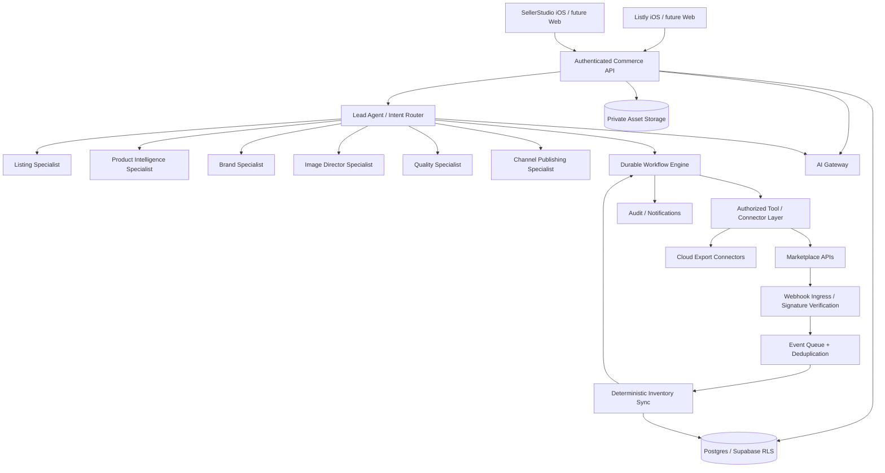

# Listly / GO Commerce — Technical Architecture

**Version:** 0.1 · **Date:** 2026-11-11 · **Status:** Proposed for engineering review  
**Companion:** `Listly_PRD.md` v0.2 · **Repository:** `go-commerce/listly` (current location)  
**Name:** Listly is provisional pending naming clearance.

## 1. Architecture decision summary

- **Native iPhone-first:** SwiftUI client; backend designed for future web/Android and SellerStudio.
- **One canonical product, multiple channel listings:** Product facts, assets, and inventory are shared; channel-specific content and status remain separate.
- **Shared commerce lead agent:** Routes conversational intents to narrow specialist agents and approved tools; a deterministic workflow engine executes and tracks side effects.
- **AI does not own inventory truth:** Signed marketplace events, API reads, transactional stock records, and idempotent jobs determine inventory and listing state.
- **Human approval for external writes by default:** Explicit user authorization for publishing, cloud uploads, and delisting; optional advance authorization for automatic cross-channel protection.
- **Shared foundation, separate apps:** Listly and SellerStudio use common identity, products, assets, brand profiles, and AI orchestration, but retain independent UIs, app-specific capabilities, and entitlements.
- **Incremental delivery:** No marketplace integration, image generation, or fully autonomous agent is required to launch MVP 1.

## 2. Logical system diagram



The diagram shows **logical** boundaries; individual services may initially be deployed together. Do not introduce distributed microservices until scale or ownership requires them.

## 3. Deployment and technology choices

| Layer | Initial choice | Notes |
|---|---|---|
| iOS | SwiftUI, async/await, PhotosPicker, Files document picker/share sheet | Keep secrets out of app binary; local draft caching |
| API / orchestration | TypeScript service or Supabase Edge Functions | Auth validation, policy enforcement, model routing |
| Database | Supabase Postgres | Migrations, row-level security, explicit ownership/tenant checks |
| Files | Private object storage | Immutable originals, versioned derivatives, signed short-lived access URLs |
| AI | Server-side model gateway | Structured outputs, tool allowlists, model/cost logging, rate limits |
| Jobs | Durable queue/workflow runner | Retry/backoff, idempotency, per-channel throttling, dead-letter queue |
| Payments | StoreKit 2 for iOS digital features; server entitlement ledger | Review Apple rules for cross-app entitlements; never assume shared subscriptions automatically work |
| Analytics | Privacy-conscious product and operational events | Separate usage telemetry from customer content |

**Architecture constraint:** Supabase Edge Functions alone do not provide durable long-running workflow semantics. Choose a queue/job runner with persistent state before enabling cross-channel sale automation.

## 4. Agent system and execution contract

### 4.1 Lead agent

Input envelope:

```json
{
  "request_id": "uuid",
  "app_id": "listly",
  "user_id": "authenticated-subject",
  "workspace_id": "uuid",
  "conversation_id": "uuid",
  "product_id": "optional-uuid",
  "user_message": "Create an Etsy listing for this mug",
  "capabilities": ["product.read", "listing.draft", "asset.read"],
  "approval_policy": "approval_required"
}
```

The lead agent determines intent, loads **minimum necessary** context, chooses specialists/tools, and returns a user-facing response and optional proposed actions. The server, not the model, validates identity, authorization, tool arguments, budgets, and approval tokens. `app_id` determines available app capabilities; it is not itself authorization.

### 4.2 Specialist responsibilities

| Specialist | Inputs | Structured outputs | Forbidden direct side effects |
|---|---|---|---|
| Product Intelligence | Images, user assertions, known facts | Extracted facts with confidence/source, missing questions | Marking inferred facts as verified |
| Brand | Approved `style.md`, visual style, examples | Normalized constraints, proposed profile changes | Silent profile mutation |
| Listing | Verified facts, brand profile, channel rules | Channel listing draft and missing-field report | Publishing |
| Image Director | Source asset, edit intent, visual constraints | Edit plan, derivative asset references, fidelity flags | Overwriting original |
| Quality | Product facts, copy, asset metadata, policy | Pass/warn/fail issues and rationale | Overriding explicit approval gates |
| Channel Publishing | Channel capabilities, validated draft | Publish/update/deactivate plan | Calling marketplace APIs directly |
| Inventory Intelligence | Stock/event status and conflicts | Explanation and resolution recommendations | Editing stock ledger without verified event |

Use **plain deterministic functions** for image resize/format conversion, export packaging, marketplace API calls, signature checks, stock arithmetic, and billing. For simple requests, route directly to one specialist without multi-agent fan-out.

### 4.3 Tool contract and approval

Each tool declares: `name`, version, JSON schema, required scopes, idempotency requirements, estimated cost, side-effect classification (`read`, `draft`, `external_write`), and audit fields. External writes require a server-issued, scoped approval record tied to user, action, resource IDs, destination, and expiry. Automatic delisting uses a separately recorded, revocable **advance authorization policy**.

Agent-generated content is untrusted until validated. Imported `style.md`, marketplace content, and image metadata are **data**, not executable system instructions. Apply strict content length/file size limits, content-type validation, injection defenses, and output schema validation.

## 5. Core domain model

Suggested entities (all workspace-scoped unless noted):

| Entity | Important fields / invariants |
|---|---|
| `workspaces` / `memberships` | Owner, roles, tenant boundary |
| `brand_profiles` | Brand name, text style, visual style, approved examples, version |
| `products` | Canonical SKU, title, condition, material, dimensions, verified facts, status |
| `product_facts` | Field, value, provenance (`user`, `image_inference`, `import`), verification status |
| `assets` | Original/derivative, storage key, checksum, source asset ID, transformation, dimensions |
| `channel_connections` | Channel, account reference, encrypted OAuth credentials, scopes, health |
| `channel_listings` | Product ID, connection ID, external listing ID, channel draft, price, quantity, status, last sync time |
| `inventory_ledger` | Product ID, event ID, signed quantity delta, source, effective time, immutable audit |
| `inventory_snapshots` | Available/reserved/committed quantity, monotonically updated version |
| `orders` / `order_lines` | Channel order IDs, status, item mappings, cancellation/refund state |
| `external_events` | Source event ID, verified payload hash, received time, processing status |
| `sync_operations` | Action, destination, idempotency key, retries, error, final result |
| `approvals` | Actor, action, exact resources, expiry, policy, revocation |
| `conversations` / `agent_runs` | Context references, tool invocations, outcomes, cost, redacted logs |
| `entitlements` / `usage_events` | Product/app, limits, credit balances, purchase source |

Never use AI-inferred product attributes as verified facts. A listing can contain unverified suggestions only when explicitly labeled and confirmed before publication.

### 5.1 Product and channel states

Product: `draft -> ready -> active -> sold` (plus `archived` and reconciliation states).  
Channel listing: `draft -> queued -> publishing -> active -> update_pending -> inactive/sold/ended`, with `failed` and `unknown` branches.  
Sync operation: `pending -> running -> succeeded/failed_retryable/failed_terminal`, plus `needs_review`.

Store **desired state** and **last observed external state** separately. Never claim a marketplace listing is inactive merely because an API request was queued or accepted; confirm through the channel response and, where needed, a follow-up read.

## 6. Main workflows

### 6.1 MVP 1: photo to export

1. User captures/selects image; app creates a local draft and uploads only with user consent.
2. Product Intelligence proposes attributes with provenance; UI asks for missing material facts.
3. User confirms facts; brand profile and marketplace rules are loaded.
4. Listing specialist returns structured title, description, keywords, attributes, and warnings.
5. Quality checks factual consistency, length, and required fields.
6. User edits in chat or form, reviews final preview, saves versioned draft.
7. Export service creates a package (`original/`, `edited/` if any, `listing.txt`, `product-details.json`, `manifest.json`).
8. iOS Files picker allows user-initiated save to iCloud Drive, Dropbox, Google Drive, or other Files providers **when installed/configured**. This is not persistent connector synchronization.

### 6.2 Direct marketplace publishing (MVP 2)

1. User authorizes a supported channel via OAuth and grants necessary scopes.
2. Adapter validates account capabilities and marketplace-specific required fields.
3. Listing specialist creates channel variant; user previews exact images, price, quantity, and description.
4. User approves publish; server records approval and idempotency key.
5. Durable job invokes marketplace API; stores external listing ID and response.
6. Status changes to `active` only after authoritative confirmation; failures surface with actionable reasons.

Each adapter exposes `capabilities()`, `validateDraft()`, `publish()`, `update()`, `deactivate()`, `fetchListing()`, `fetchOrders()` and optional `verifyWebhook()`. Unsupported operations must be explicitly represented; never imply universal marketplace support. Validate API access/terms for Shopify, eBay, and Etsy before committing a release.

### 6.3 Verified sale and cross-channel protection (V1.5)

1. Signed webhook or authenticated API poll identifies order event; verify authenticity and deduplicate by source event ID.
2. Resolve external listing to canonical product; verify order state and quantity semantics. Record immutable event.
3. Transactionally adjust/reserve inventory with version checks; evaluate other active channel listings.
4. If seller selected **ask-first**, notify and await scoped approval; clearly label exposure while waiting.
5. If seller enabled **auto-protect**, enqueue permitted deactivation/stock-zero actions immediately, then notify seller.
6. For each channel, apply idempotent API call, rate limiting, retry/backoff, and state verification.
7. Report **per-channel** `confirmed inactive`, `pending`, `failed`, or `manual action required` outcomes.
8. Run scheduled reconciliation against channel APIs to detect missed events, disconnects, and stock divergence.

**Important:** Cross-channel protection is best effort; webhook latency, concurrent purchases, API outages, and unsupported channels mean zero overselling cannot be guaranteed. Do not silently relist an item after cancellation/refund; require an explicit restock policy or user approval.

### 6.4 SellerStudio handoff

SellerStudio edits are new immutable derivatives linked to the same product and original. Users approve images before Listly uses them in a listing. Shared services enforce workspace membership and app entitlements. A product can exist in SellerStudio without any channel listing.

## 7. Security, privacy, and reliability

- Supabase RLS on tenant-owned tables; server-side authorization for every mutation and signed URL issuance.
- Encrypt OAuth refresh tokens at rest using managed secrets/KMS; never expose them to iOS clients or agents.
- Verify marketplace webhook signatures and replay windows; retain provider-specific verification evidence.
- Encrypt transport; limit access to customer photos and brand documents; support export and deletion requests.
- User controls whether originals, conversations, and style files are retained; define retention/deletion policies before launch.
- Upload scanning, MIME validation, size limits, image processing sandbox, and avoidance of EXIF leakage in public exports.
- Rate limits, AI budget caps, per-workspace quotas, connector circuit breakers, retries, and dead-letter inspection.
- Audit all publishing, delisting, profile updates, entitlement changes, and stock adjustments.
- Support account disconnect and revoke tokens; retain minimal order/audit records as legally and operationally required.
- Follow platform policies and prohibit unsupported browser automation or scraping of seller accounts.

## 8. Brand profile contract

```yaml
brand_profile:
  id: uuid
  version: 3
  name: "Otto Art"
  text_style:
    markdown_source: "style.md"
    voice: "thoughtful, contemporary"
    prohibited_phrases: ["must-have"]
    approved_examples: []
  visual_style:
    markdown_source: "visual-style.md"
    preserve_original_colors: true
    preserve_product_geometry: true
    reference_assets: []
  marketplace_overrides: {}
```

User-provided Markdown is parsed to normalized, versioned constraints. A model may **propose** updates; only an approved action saves a new version. Marketplace rules and factual accuracy outrank style instructions. Provide profile import/export and per-product overrides without mutating the default.

## 9. API boundaries (illustrative)

- `POST /v1/conversations/{id}/messages` — submit chat input; returns response and proposed actions.
- `POST /v1/products` / `PATCH /v1/products/{id}` — canonical product CRUD.
- `POST /v1/products/{id}/generate-listing` — asynchronous draft generation.
- `GET /v1/products/{id}/channel-listings` — channel status and external links.
- `POST /v1/channel-listings/{id}/publish-intent` — validation + approval proposal.
- `POST /v1/approvals/{id}/confirm` — approve exact operation.
- `POST /v1/exports` — create export package or file-picker handoff.
- `POST /v1/webhooks/{provider}` — signed provider event ingress (not client-authenticated).
- `GET /v1/sync-operations/{id}` — operation state and per-channel results.

All mutating endpoints require auth, resource authorization, request validation, and idempotency keys where retries could duplicate actions. Prefer server-side generated IDs and opaque client references.

## 10. Release gates and tests

### MVP 1
- User can create a listing from an image and chat, confirm facts, apply a `style.md`, revise, save, and export.
- No unverified brand/material/dimensions silently enter published-ready fields.
- Original photo remains unchanged; derivative assets are traceable.
- Export package is valid and includes a manifest; user controls destination.
- RLS isolation tests, malicious style-file tests, budget/rate-limit tests, and accessibility checks pass.

### MVP 2
- At least one authorized marketplace connector can publish and report an external listing ID.
- Duplicate submissions cannot create duplicate listings under retry.
- Unauthorized or expired approval cannot trigger external writes.
- API failure is visible and does not masquerade as success.

### V1.5
- Verified sale events are deduplicated; stock changes are transactionally consistent.
- Ask-first and auto-protect policies are tested independently.
- Concurrent orders, late events, cancellations, API outages, expired OAuth, and failed delisting are covered by integration tests.
- Per-channel confirmation is truthful and reconciliation can detect drift.

## 11. Delivery sequence and repository layout

Keep the existing `go-commerce/listly` path. Create shared packages alongside it only when the second consumer exists; avoid a premature monorepo migration.

```text
go-commerce/
  listly/
    PRD.md
    ARCHITECTURE.md
    ios/Listly/
    backend/
    docs/
  seller-studio/                 # later
  packages/                     # later: contracts, brand schema, tokens
  services/                     # later: orchestrator, catalog, assets, sync
```

**Sprint 0:** Confirm scope, marketplace API feasibility, initial data contracts, RLS, AI budget assumptions.  
**Sprint 1:** SwiftUI shell, product capture, photo upload, structured facts.  
**Sprint 2:** Chat orchestration, listing specialist, style import, preview/revision.  
**Sprint 3:** Draft catalog, Files export, reliability/security tests, beta.  
**Later:** Marketplace connector proof of concept; durable sync engine; SellerStudio asset handoff.

## 12. Open decisions

1. Which marketplace first? Validate real developer access and policy constraints before selecting Shopify/eBay/Etsy.
2. Should accounts be required at first launch, or can users try a limited guest flow?
3. How many free AI generations and revisions are affordable per user?
4. What retention defaults apply to photos, conversations, and imported style documents?
5. What qualifies as a verified sale on each marketplace (paid, committed, shipped)?
6. Which automatic protection actions are allowed per channel, and what happens when a channel lacks delist APIs?
7. How will iOS purchase entitlements be represented across independently distributed apps?
8. What level of image fidelity testing is required before SellerStudio derivatives can be exported?

## 13. Recommended next engineering deliverables

- `docs/AGENT-CONTRACTS.md`: versioned input/output JSON schemas and tool policies.
- `docs/CHANNEL-ADAPTERS.md`: provider-specific capability and authorization matrix.
- `backend/supabase/migrations/`: initial workspace, brand, product, asset, and listing schemas with RLS tests.
- `docs/WORKFLOWS.md`: state machines, approval rules, inventory sync failure/reconciliation scenarios.
- SellerStudio PRD scoped against the same brand, product, and asset contracts.
